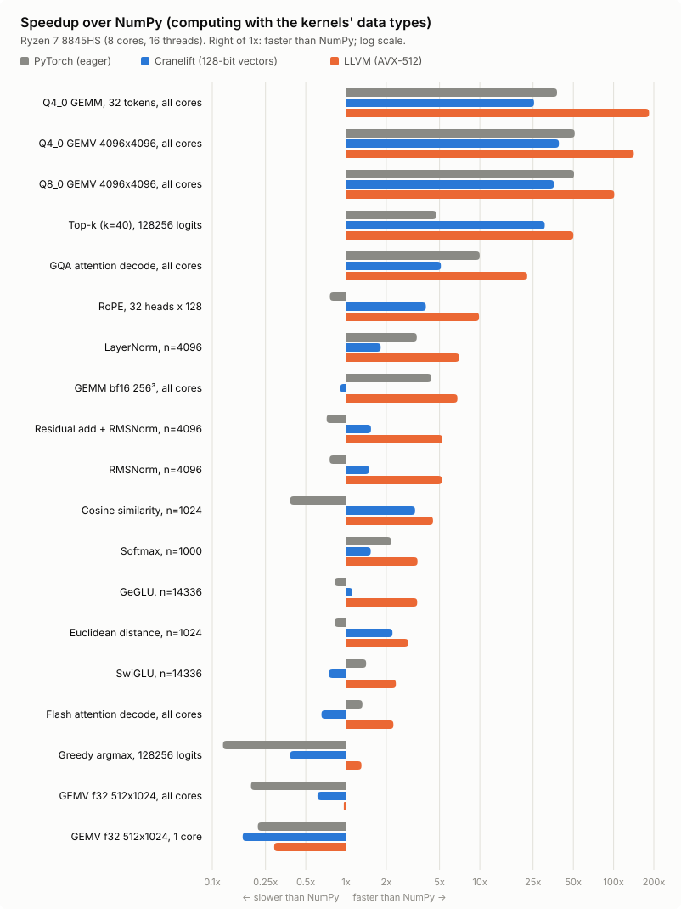

# Kernels

`examples/kernels/` holds verified kernels for LLM inference (norms, activations, RoPE, decode attention, quantized GEMV and prefill GEMM, greedy and top-k selection), vector search, normalization, a byte histogram and a sparse matrix-vector product. The vector kernels are vector-length agnostic: each processes `vl` lanes per step with FMAs and finishes with masked `ldm`/`stm`, so the same source runs 128-bit vectors on Cranelift and AVX2/AVX-512/SVE-width vectors on LLVM. Every kernel takes element counts, and each `.air` file has matching `.airb` bytecode.

| Kernel | Signature | Use case |
|---|---|---|
| `cosine_similarity.air` | `(a:ptr, b:ptr, n:i64)->f32` | Embedding search and RAG |
| `euclidean_distance.air` | `(a:ptr, b:ptr, n:i64)->f32` | Nearest neighbors, vector quantization |
| `softmax.air` | `(x:ptr, out:ptr, n:i64)->f32` (returns the sum of exponentials) | Attention weights, numerically stable; `exp` vectorized in AIR (no libm call) |
| `rmsnorm.air` | `(x:ptr, w:ptr, out:ptr, n:i64)->f32` (returns the scale) | Token normalization (LLaMA, Mistral, Gemma) |
| `layernorm.air` | `(x:ptr, w:ptr, b:ptr, out:ptr, n:i64, eps:f32)->f32` (returns the scale) | LayerNorm with weight and bias (GPT-2, BERT, Whisper, ViT): the mean, then the variance from the deviations (accurate when the mean is large next to the spread), then the normalization |
| `gemv_f32.air` | `(a:ptr, x:ptr, y:ptr, m:i64, k:i64)` | Matrix-vector projection, 4 rows at a time (independent FMA chains, x loaded once per 4 rows) |
| `gemv_par.air` | `gemv_par(a:ptr, x:ptr, y:ptr, m:i64, k:i64)` | The same on all cores, blocks of 16 rows per `par` index; `bench(m, k, reps)->f32` runs it from the CLI or MCP |
| `gemm_bf16.air` | `gemm_bf16(c:ptr, a:ptr, b:ptr, m:i64, n:i64, k:i64)` | bf16 matrix multiply into f32 on all cores: `par` over 16-row blocks, each an `mm` (AMX, SME or FMA) |
| `flash_attention.air` | `(q:ptr, kv:ptr, idx:ptr, sink:ptr, out:ptr, h:i64, d:i64, nk:i64, scale:f32)` | One decode step of sparse multi-query attention with an attention sink, as in DeepSeek V4 Pro (128 heads, 512-dim shared K=V entries, 1152 selected entries). Runs on all cores: one `par` gathers the selected entries, a second runs FlashAttention-2 (blocks of 64 entries, both products on `mm`) for groups of 8 heads |
| `gqa_attention.air` | `gqa_attention(q:ptr, kc:ptr, vc:ptr, out:ptr, nh:i64, nkv:i64, hd:i64, t_len:i64, max_ctx:i64)` | One decode step of grouped-query attention (Llama 3, Mistral, Qwen) over a bf16 KV cache, on all cores (flash-decoding): a `par` over (KV head, 256-position split) tasks scores and mixes 4 query heads at a time with their sums in registers, widening each K and V vector once for the 4; K is stored in tiles of 32 positions (`[head_dim x 32]`) so scores take positions in lanes; a second `par` merges the splits |
| `add_rmsnorm.air` | `(x:ptr, res:ptr, w:ptr, out:ptr, n:i64, eps:f32)->f32` | Residual add fused with RMSNorm between sublayers (vLLM's `fused_add_rms_norm`): updates the residual stream and normalizes it in two passes |
| `rope.air` | `(x:ptr, heads:i64, dim:i64, cos:ptr, sin:ptr)` | Rotary position embedding in place, LLaMA/NeoX rotate-half layout, from a row of the cos/sin cache |
| `swiglu.air` | `(gate:ptr, up:ptr, out:ptr, n:i64)` | `silu(gate) * up` with `exp` vectorized in AIR (Cephes polynomial; 2^n built by reading the f32 lanes as i32), no libm call |
| `geglu.air` | `(gate:ptr, up:ptr, out:ptr, n:i64)` | `gelu(gate) * up` with PyTorch's tanh-approximated GELU (Gemma's MLP gate), written as `g / (1 + exp(-2u))`: one vectorized `exp`, no tanh or libm call |
| `argmax.air` | `(x:ptr, n:i64)->i64` | Greedy decoding: first index of the largest logit, one pass with four independent (value, index) accumulator sets |
| `topk.air` | `(x:ptr, n:i64, k:i64, vals:ptr, idx:ptr)` | Top-k sampling's selection: the k largest logits in order with their token ids. One pass that compares the maximum of each group of 4 vectors with the current k-th best and scans only groups (then vectors) that beat it |
| `q8_gemv.air` | `q8_gemv(wq:ptr, scales:ptr, x:ptr, y:ptr, m:i64, k:i64)` | Q8_0 (llama.cpp) matrix-vector product on all cores: int8 weights in 32-blocks with f16 scales (as GGUF stores them), packed in 64-row chunks with each row's 4 consecutive values in one 32-bit lane and stored plus 128; activations quantized on the fly with their block sums; unsigned-by-signed int8 dots on `vdotu`, minus 128 times the activation sums |
| `q4_gemv.air` | `q4_gemv(wq:ptr, scales:ptr, x:ptr, y:ptr, m:i64, k:i64)` | Q4_0 (llama.cpp) matrix-vector product: 4-bit weights, half of Q8_0's bytes; GGUF's own nibble bytes in the same lane order, unpacked in registers (a mask and a shift) as unsigned values for the same `vdotu`s, minus 8 times the activation sums |
| `q4_gemm.air` | `q4_gemm(wq:ptr, scales:ptr, x:ptr, y:ptr, m:i64, k:i64, n:i64)` | Q4_0 matrix product for prefill: n tokens against q4_gemv's packed matrix, one task per 64-row chunk with `qmat_batch` loading and unpacking each weight vector once per 8 tokens (4 with 128-bit vectors); every token gets exactly q4_gemv's result |
| `histogram.air` | `histogram(x:ptr, n:i64, bins:ptr)` | Byte histogram on all cores (adds to 256 i64 bins, as `numpy.bincount(x, minlength=256)`): each 64 KB chunk counts into private tables, then adds them to the shared bins with one `atomic add` per bin. `histogram_atomic` does one `atomic add` per byte instead, for comparison |
| `spmv.air` | `spmv(rowptr:ptr, cols:ptr, vals:ptr, x:ptr, y:ptr, m:i64)` | Sparse matrix-vector product, CSR as scipy stores it (i64 row offsets, i32 columns, f32 values), on all cores: one `par` index per 64 rows, which `par` balances however uneven the rows are. `spmv_queue` takes the blocks from an `atomic add` work queue instead, and `spmv_gather` reads x with `vgather` instead of scalar loads, for comparison |
| `llama_decode.air` | `llama_decode(model:ptr, cfg:ptr, cache:ptr, token:i64, pos:i64, h:ptr, eps:f32)->i64`, `llama_prefill(model:ptr, cfg:ptr, cache:ptr, tokens:ptr, n:i64, pos:i64, h:ptr, eps:f32)->i64` | A whole Llama-style decode step in one call, token in, next token out; and a whole prompt in one call: see [Llama in one call](llama.md) |

`crates/achainsaw-codegen/tests/kernels.rs` checks every kernel against a scalar reference at each ISA level, including lengths that end in partial vectors. The benchmark verifies them against NumPy and times each backend and ISA level, with NumPy and (when installed) PyTorch as baselines:

```bash
python benchmarks/benchmark_kernels.py                  # host ISA, every available backend
python benchmarks/benchmark_kernels.py --isa all        # also sweep sse/avx/avx2/avx512 (or neon/sve/...)
python benchmarks/benchmark_kernels.py --json out.json  # machine-readable results
python benchmarks/benchmark_kernels.py --no-torch       # without the PyTorch baseline
```

Compared with NumPy and PyTorch, from `benchmarks/benchmark_kernels.py` on a Ryzen 7 8845HS (8 cores, 16 threads), best of three runs. Kernels marked "all cores" use `par`; the others run on one core:
- **NumPy** computes with the kernels' data types: bf16 inputs are stored as bf16 bits and widened in each call, and Q8_0 and Q4_0 weights stay integers. Its GEMV and GEMM use multithreaded OpenBLAS (16 threads).
- **PyTorch** 2.14 (CPU wheel, eager, its default 8 threads) runs its own fastest CPU path for each kernel, and the benchmark checks its results too. GEMM and attention use native bf16 (oneDNN; bf16 outputs). The quantized GEMVs use its weight-only kernels, the path torchao takes on CPU, with bf16 activations instead of int8 ones. Q4_0 maps to int4 with the same 32-blocks; Q8_0 maps to int8 with one scale per row, since PyTorch has no per-block int8 kernel, which is less work than Q8_0.

The parentheses give the speedup over NumPy:

<picture>
  <source media="(prefers-color-scheme: dark)" srcset="kernels-vs-numpy-dark.svg">
  
</picture>

| Kernel | NumPy | PyTorch | Cranelift (128-bit) | LLVM (512-bit) |
|---|---|---|---|---|
| Q4_0 GEMV 4096x4096, all cores | 5.58 ms (the same, from 4-bit values) | 109 µs (51x; int4 weight-only kernel, bf16 activations) | 143 µs (39x) | 39.4 µs (142x) |
| Q4_0 GEMM 4096x4096 on 32 tokens (prefill), all cores | 66.9 ms (int widened to f32 per call) | 1.77 ms (38x; int4 weight-only kernel, bf16 activations) | 2.63 ms (25x) | 363 µs (184x) |
| Q8_0 GEMV 4096x4096, all cores | 5.62 ms (int8 widened to f32 per call; NumPy has no int8 matmul) | 111 µs (51x; int8 weight-only kernel, one scale per row, bf16 activations) | 157 µs (36x) | 55.5 µs (101x) |
| Top-k, k=40 of 128256 logits | 755 µs (`argpartition`, then `argsort` of the 40) | 160 µs (4.7x; `topk`) | 24.7 µs (31x) | 15.1 µs (50x) |
| GQA decode attention, Llama 3 8B: 32 query / 8 KV heads x 128, 4096 positions of a bf16 cache, all cores | 4.72 ms (the cache widened to f32 per call) | 473 µs (10x; `scaled_dot_product_attention` with each group's heads as query positions, bf16) | 415 µs (11x) | 118 µs (40x) |
| Byte histogram, 16 MB, all cores | 19.3 ms (`bincount`) | 4.65 ms (4.2x; `bincount`) | 596 µs (33x) | 515 µs (38x) |
| SpMV, CSR 262144x262144 with 6.8M power-law nonzeros, all cores | 14.9 ms (products, then `add.reduceat` per row) | 3.55 ms (4.2x; CSR tensor `mv`) | 1.07 ms (14x) | 1.07 ms (14x) |
| RoPE, 32 heads x 128 | 7.5 µs | 9.9 µs (0.76x) | 1.9 µs (3.9x) | 0.76 µs (9.9x) |
| LayerNorm, n=4096 | 9.8 µs | 2.9 µs (3.4x) | 5.4 µs (1.8x) | 1.4 µs (7.0x) |
| GEMM bf16 -> f32, 256³, all cores | 166 µs | 38.3 µs (4.3x; bf16 output) | 183 µs (0.91x) | 24.4 µs (6.8x) |
| Residual add + RMSNorm, n=4096 | 6.3 µs | 8.8 µs (0.71x) | 4.1 µs (1.5x) | 1.2 µs (5.3x) |
| RMSNorm, n=4096 | 5.2 µs | 6.9 µs (0.76x) | 3.5 µs (1.5x) | 1.0 µs (5.1x) |
| Cosine similarity, n=1024 | 2.1 µs | 5.5 µs (0.39x) | 0.64 µs (3.3x) | 0.47 µs (4.5x) |
| Softmax, n=1000 | 2.6 µs | 1.2 µs (2.3x) | 1.7 µs (1.6x) | 0.76 µs (3.5x) |
| GeGLU (GELU-tanh gate), n=14336 | 17.7 µs | 21.5 µs (0.82x) | 15.9 µs (1.1x) | 5.2 µs (3.4x) |
| Euclidean distance, n=1024 | 1.4 µs | 1.7 µs (0.81x) | 0.63 µs (2.2x) | 0.48 µs (2.8x) |
| SwiGLU, n=14336 | 9.9 µs | 7.0 µs (1.4x) | 13.3 µs (0.74x) | 4.2 µs (2.3x) |
| Flash attention decode, DeepSeek V4 Pro, all cores | 1.18 ms | 890 µs (1.3x; `scaled_dot_product_attention`, bf16 output) | 1.80 ms (0.65x) | 522 µs (2.3x) |
| Greedy argmax, vocabulary 128256 | 6.0 µs | 49.9 µs (0.12x) | 15.7 µs (0.38x) | 4.6 µs (1.3x) |
| GEMV f32 512x1024, all cores | 5.2 µs | 26.7 µs (0.20x) | 8.5 µs (0.61x) | 5.4 µs (0.96x) |
| GEMV f32 512x1024, 1 core | 5.6 µs (all cores) | 25.6 µs (0.22x, all cores) | 33.2 µs (0.17x) | 19.3 µs (0.29x) |

**Atomics.** Both `par` kernels that share memory come with a second form, timed by the same benchmark and left out of the figure:
- **Contended atomics are slow.** `histogram_atomic`, one `atomic add` on the shared bins per byte, takes 42 ms on both backends: 0.46x NumPy, 70–80x the private tables, and slower than its 29 ms on one thread, since the bins' 32 cache lines move between cores on almost every byte. Count privately and merge with one atomic per bin: `histogram` takes 3.6 ms (LLVM) to 4.0 ms (Cranelift) on one thread and 7x less on 16.
- **`par` is a work queue already.** `spmv`'s rows have 1 to 58000 nonzeros (Zipf). `spmv_queue`, 64 calls taking 64-row blocks from an `atomic add` counter, takes 1.07 ms like the `par` over blocks, on both backends. With one row per index or per claim, both take 3.8–4.0 ms instead: the `par` dispatch of an index costs about what an `atomic add` on a shared counter does. SpMV is memory-bound (8 bytes per nonzero and a scattered read of x), so 16 threads run it 5.7x faster than one (6.1 ms). Vector code does not change that: `spmv_gather`, one `vgather` of x per vector of nonzeros, takes 1.21 ms on Cranelift and 1.14 ms on LLVM against `spmv`'s 1.16 and 1.09, and with one thread 9.28 and 6.38 ms against 6.52 and 6.10 (Cranelift gathers lane by lane; LLVM uses AVX-512's `vgatherdps`).

`python benchmarks/plot_vs_numpy.py results.json docs/kernels-vs-numpy` redraws the figure from `benchmark_kernels.py --json results.json`.

Every pull request also runs a performance check in CI: [`benchmarks/perf_compare.py`](../benchmarks/perf_compare.py) builds the PR's base and head on the same runner, runs each side's kernel benchmarks and a 4-layer decode alternately for 5 rounds, and fails if the best time of any kernel on either backend got more than 25% slower. Comparing best times from fresh processes keeps runner noise out; the job summary lists every ratio.

LLVM is ahead of PyTorch on every kernel: 2.8x on Q4_0 and 2.0x on Q8_0 GEMV and 4.9x on the Q4_0 prefill GEMM against its quantized kernels; 1.6x on bf16 GEMM and 1.7x on DeepSeek's attention, where both use AVX512-BF16 dot products on this CPU (`mm` takes them with fast math, which the benchmark sets); 4.0x on GQA attention; 9.1x on the histogram and 3.3x on SpMV; and 1.5–13x on the small kernels, where each PyTorch eager op costs a few µs of dispatch. PyTorch's GQA time is its best form: with `enable_gqa=True` and one query position per head, `scaled_dot_product_attention` leaves its fast path and takes 18x as long.

Where the remaining gaps come from:
- **Cranelift's vector width.** Cranelift has only 128-bit vectors, so vector-bound kernels (SwiGLU, argmax, and `mm` in GEMM and attention) do a quarter of the work per instruction of AVX-512 code; on LLVM the same sources beat NumPy.
- **f32 GEMV against multithreaded BLAS.** On all cores LLVM and OpenBLAS are level (5.4 vs 5.2 µs; a `par` costs about 1 µs of dispatch at 16 threads). The single-core row compares one core with NumPy's 16 threads: OpenBLAS on one thread (`OPENBLAS_NUM_THREADS=1`) takes 21.6 µs, slightly slower than LLVM. PyTorch's x86 wheel calls MKL here, which runs this size on one thread and is slower on AMD CPUs.

**Quantized GEMV on `vdot`.** Each 32-bit lane of the packed weights holds 4 consecutive values of one row, so one `vdot` (VNNI `vpdpbusd`, Arm `sdot`) does 4 int8 multiply-adds per lane against a broadcast group of 4 activations, and a Q4_0 nibble vector unpacks into two such vectors in registers. Every task walks its 64-row chunk block by block, so each block's bytes are read in one pass (walking each row strip through the whole chunk instead strided through 256 KB and fell out of L3). Against the previous kernels, which unpacked into a tile for an i8 `mm`, the 4096x4096 GEMVs got 2.0–2.3x faster on LLVM and 1.6–1.9x on Cranelift, and Q4_0 is faster than Q8_0 on LLVM and as fast on Cranelift.

Fuel checks are inline (a decrement and a compare per branch, on a counter kept in a register), so loops pay almost nothing for runaway protection. The rare slow path calls the runtime through a stub that preserves every register, so it does not make Cranelift spill loop values: before that, the fuel checks made Cranelift's GEMV 2.6x slower. They are compiled in only when a run needs them: under a fuel budget, a memory quota (so code stops at the branch after a failed `alloc`) or the MCP sandbox. A budget or quota set after compiling still holds: the next call compiles the module again with checks and runs that copy. Under a budget or in the sandbox, a loop whose trip count is known on entry pays for its checks once: one that counts `i` (or moves a pointer) to a bound fixed before it, by a constant or a `vl`, tested at the top, in the middle or at the bottom, with no calls inside and every way around the body equally many branches (an if/else whose arms are one block each qualifies): a block in front of it computes the fuel the whole loop takes and the bytes its `x[i]` accesses span, charges the fuel at once and checks the span against the sandbox, then runs a copy of the loop without checks. When the budget cannot cover the loop or an access would leave the sandbox, the original loop runs and stops where it always did, so results, fuel use and errors are unchanged. Sandboxed, on 65536 elements, LLVM runs the popcount sum in 5.0 µs instead of 36, the i32 dot product in 3.5 instead of 49 and the saxpy in 4.2 instead of 38, as fast as without checks; Cranelift runs them in 40–41 µs instead of 55–75. A bottom-tested sum runs in 3.6 µs instead of 27 on LLVM (Cranelift 16 instead of 37), a sum with an if/else in 3.6 instead of 55 (Cranelift 40 instead of 67), and one that walks a pointer to an end pointer in 16 instead of 34 (Cranelift 28 instead of 40). A check is an exit from the loop that calls the runtime, so LLVM does not vectorize a loop that has one; without checks it vectorizes scalar loops. On 65536 elements, with LLVM, a sum of popcounts went from 27.1 to 4.2 µs, a scalar saxpy from 27.1 to 4.5 µs and an i32 dot product from 27.4 to 2.5 µs (Cranelift, which does not vectorize: 40.0 to 26.6, 39.6 to 39.4, 32.6 to 26.5 µs). Of the kernels here, which are vector code already, `topk` got 22% faster on LLVM and `q8_gemv` 20% on Cranelift; the rest moved by at most 11%.
